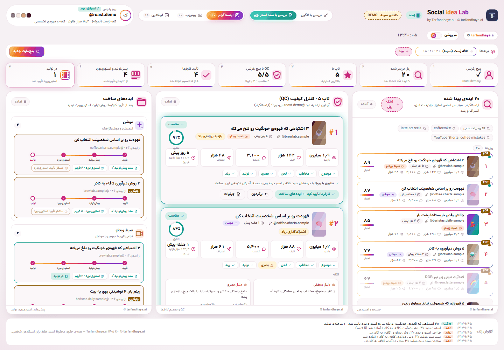
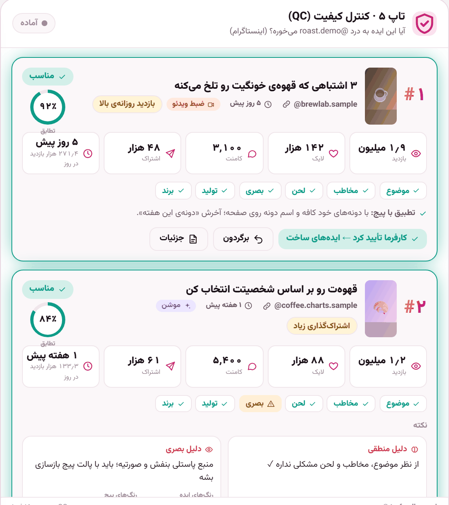
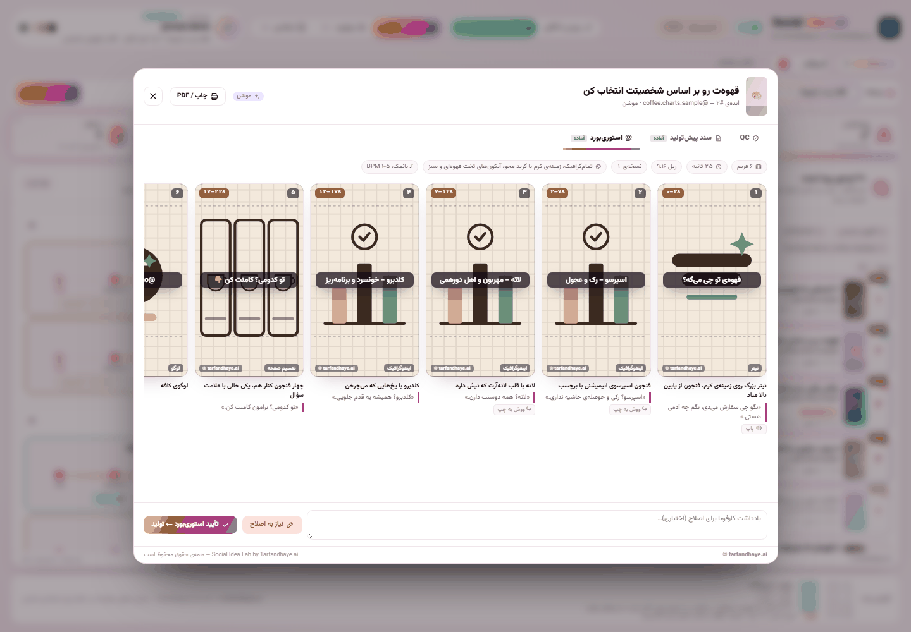

# Social Idea Lab by Tarfandhaye.ai

ساخته‌ی پیج **[@tarfandhaye.ai](https://www.instagram.com/tarfandhaye.ai/)** · کانال تلگرام: [t.me/tarfandhaye_ai](https://t.me/tarfandhaye_ai)

اسکیل Claude Code برای پیدا کردن ایده‌ی ویدیو. برای هر برند، ریل‌ها و ویدیوهای پربازدید هم‌موضوع رو توی **اینستاگرام، یوتیوب یا لینکدین** پیدا می‌کنه، امتیاز می‌ده، می‌گه کدومشون به برند تو می‌خوره، و برای ایده‌ی انتخابی‌ت سند پیش‌تولید و استوری‌بورد می‌سازه.

- **دقیق.** صفحه‌ی خود ریل‌ها رو توی مرورگر می‌خونه: بازدید، لایک، کامنت، اشتراک، تاریخ و فالوئر پیج. زیر هر عدد نوشته از کجا خونده شده و هیچ عددی حدس زده نمی‌شه.
- **بدون لاگین.** رمز اینستاگرام و یوتیوب نمی‌خواد. صفحه‌های عمومی رو مثل یه بازدیدکننده می‌خونه.
- **فقط می‌خونه.** لایک، فالو، کامنت یا پیام نمی‌زنه.
- **همه‌چی روی کامپیوتر خودته.** هر کس روی Claude Code و کامپیوتر خودش اجرا می‌کنه؛ به هیچ سرور دیگه‌ای وابسته نیست.
- **ایده برداشته می‌شه، نه خود ویدیو.** اسم پیج منبع کنار هر ایده می‌مونه.

---

## چی لازم داری

1. **Claude Code** با یک مرورگر وصل (Claude in Chrome یا مرورگر داخلی اپ).
2. **اینترنت برای بار اول.** پایتون رو لازم نیست خودت نصب کنی: اسکریپت شروع با [uv](https://docs.astral.sh/uv/) خودش پایتون ۳٫۱۲ رو نصب می‌کنه (یک‌بار، حدود ۲۰ مگ) و اسکیل با همون اجرا می‌شه. به پایتون سیستمت دست نمی‌زنه.

## نصب (یک‌بار)

1. فایل zip رو **Extract** کن.
2. پوشه‌ی `social-idea-lab` رو کپی کن توی پوشه‌ی اسکیل‌های Claude:
   - ویندوز: `C:\Users\<اسمت>\.claude\skills\`
   - مک و لینوکس: `~/.claude/skills/`

   (باید بشه `…\.claude\skills\social-idea-lab\SKILL.md`)
3. Claude Code رو ببند و دوباره باز کن.
4. (اختیاری) برای آماده کردن پایتون از قبل، داخل همین پوشه:
   - ویندوز: روی `start.cmd` دوبار کلیک کن.
   - مک و لینوکس: توی ترمینال `sh start.sh` رو بزن.

   بار اول uv و پایتون نصب می‌شن و داشبورد باز می‌شه. اگه این کار رو نکنی، Claude اولین بار خودش انجامش می‌ده.

## محیط ابزار

| | |
|---|---|
|  |  |
| **داشبورد:** ۲۰ ایده، تاپ ۵ با QC، ایده‌های در حال ساخت | **QC:** عددها، تاریخ انتشار و اینکه چرا به برند می‌خوره |
|  | |
| **استوری‌بورد:** فریم‌به‌فریم با متن و صدا | |

همه‌ی عکس‌ها از داشبورد نمونه با داده‌ی ساختگی (یه کافه‌ی فرضی) هستن.

## استفاده

به Claude بگو:

> «با اسکیل social-idea-lab داشبورد نمونه رو باز کن»

یه کافه‌ی فرضی با ایده‌ها، QC و استوری‌بورد می‌بینی؛ همه‌چی ساختگیه و به کار واقعی دست نمی‌زنه. بعد برای برند خودت:

> «با اسکیل social-idea-lab برای برند من ایده‌ی ریل پیدا کن»

Claude چند سؤال کوتاه می‌پرسه (برند چیه؟ لینک پیج یا سند استراتژی داری؟ کدوم پلتفرم؟) و بعد:

1. **۲۰ ایده** از ۶ ماه اخیر با بازدید، لایک، کامنت، اشتراک، تاریخ انتشار و اسم پیج منبع پیدا می‌کنه و ۵ تای برتر رو جدا می‌کنه. امتیاز با بازدید روزانه حساب می‌شه، پس ویدیوی قدیمی فقط به‌خاطر زمان بالا نمی‌ره.
2. **QC** می‌کنه: هر ایده به برند می‌خوره یا نه، با دلیل منطقی و بصری و یه جایگزین. هیچ ایده‌ای خودکار حذف نمی‌شه.
3. **داشبورد** رو باز می‌کنه. اونجا تو (یا مشتری‌ت) **تأیید، تأیید جایگزین یا حذف** می‌زنی.
4. برای ایده‌های تأییدشده **سند پیش‌تولید** (آدم، لوکیشن، تجهیزات، نرم‌افزار، برنامه) و بعد **استوری‌بورد** فریم‌به‌فریم می‌سازه.
5. وقتی استوری‌بورد رو تأیید کنی، ایده «در تولید» می‌شه. همه‌ی سندها قابل چاپ و PDF هستن.

### چند نکته‌ی داشبورد
- بالای صفحه پلتفرم رو عوض کن (اینستاگرام، یوتیوب، لینکدین): هر پلتفرم ایده‌ها و تصمیم‌های جدا داره.
- **«+ برند»** برای چند برند یا چند مشتری. هر برند جدا بررسی می‌شه و دکمه‌ی «بنچ‌مارک جدید» خودش رو داره. با × یه برند از فهرست برداشته می‌شه (چیزی پاک نمی‌شه، بایگانی می‌شه).
- **«لینک ریل»**: لینک ریلی که خودت دیدی رو بچسبون؛ Claude توی جستجوی بعدی می‌خونتش.
- دکمه‌ی «تم روشن / تیره» بالای صفحه.

### داشبورد آنلاین برای مشتری
از Claude بخواه: «داشبورد آنلاین رو بساز». یه صفحه روی claude.ai می‌سازه که مشتری از هر جا (حتی وقتی کامپیوتر تو خاموشه) بازش می‌کنه:
- ایده‌ها، QC، پیش‌تولید و استوری‌بوردها رو می‌بینه و **تأیید، حذف، تصمیم استوری‌بورد، لینک ریل، بنچ‌مارک جدید، برند تازه و فایل استراتژی (PDF یا عکس)** رو ثبت می‌کنه.
- همه‌ی این‌ها آنلاین ذخیره می‌شه و Claude مستقیم می‌خونه؛ کافیه بهش بگی «کارهای مشتری رو از داشبورد آنلاین بخون».
- برای اینکه مشتری بتونه ثبت کنه، از منوی **Share** صفحه بهش دسترسی **Contributor** بده.
- Claude بعد از هر مرحله همون صفحه رو به‌روز می‌کنه و لینک عوض نمی‌شه.
- **روند کار روی صفحه:** برند رو بساز ← روی هر پلتفرم (اینستاگرام، یوتیوب، لینکدین) بزن ← بازه‌ی زمانی و پیج‌های ایرانی یا خارجی رو انتخاب کن ← «شروع جستجو با Claude». می‌شه هر سه رو پشت‌سرهم زد؛ همه «در حال جستجو» می‌شن و هر کدوم تموم شد، همون لحظه با «تموم شد ✓» روی صفحه میاد. برای این کار Claude Code روی کامپیوترت باید باز باشه (خودش هر ۲ دقیقه صفحه رو چک می‌کنه).

## سؤال‌های رایج

**بازدید یا لایک بعضی ریل‌ها خالیه.** اینستاگرام بدون لاگین همیشه همه‌ی عددها رو نشون نمی‌ده و یوتیوب «اشتراک» رو نشون نمی‌ده. خالی می‌مونه و امتیاز با بقیه‌ی عددها حساب می‌شه. برای عددهای کامل‌تر، خودت توی مرورگر با حساب خودت لاگین کن و به Claude بگو «بررسی با لاگین» (فقط می‌خونه).

**داشبورد باز نشد.** از Claude بخواه دوباره بازش کنه. آدرسش `http://127.0.0.1:8770` ـه؛ فایل HTML داخل اسکیل رو مستقیم باز نکن.

**اطلاعات کجا ذخیره می‌شه؟** توی پوشه‌ی `Social Idea Lab` داخل پوشه‌ی خونه‌ات.

---

© tarfandhaye.ai — فقط برای استفاده‌ی شخصی؛ شرایط مجوز توی `LICENSE.md`.
